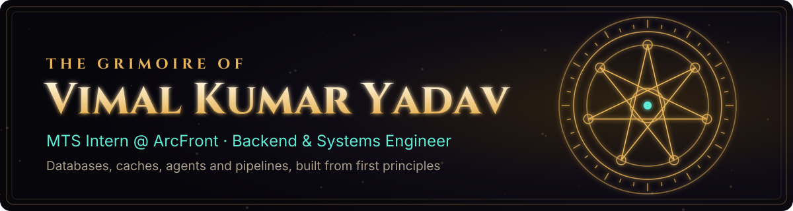

  

  
  
  
  
  

### ✦ About

I'm a backend and systems engineer in Bengaluru. My favourite way to understand a system is to rebuild it.

- 🔭 **MTS Intern @ ArcFront**: shipping production RL training environments (full-stack clones of real platforms used to train frontier models) and an agentic platform that fixes QA-reported bugs, verifies each fix in a real browser and opens the PR.
- 🧪 Previously: Playwright regression automation and NeetoCI pipelines at **Neeto (BigBinary)**; founding backend engineer at **Bricks Education**.
- 🎓 Computer Science at **Scaler School of Technology** and **BITS Pilani**.
- 🏆 Rank **158 / 15,000+** teams in the Meta × Hugging Face RL Hackathon.

### ✦ Grimoires (things I built from scratch)

| Project | What it is |
| --- | --- |
| [**VersionDB**](https://github.com/vimalyad/version-db) | Zero-dependency relational database in Java: slotted pages, ARIES WAL recovery, PostgreSQL-style MVCC, B+Tree, cost-based optimizer. ~12× read throughput vs a lock-based baseline; 424 tests. |
| [**CRDT-Native Relational Database**](https://github.com/vimalyad/udaan-relational-database) | Embedded SQL engine in Rust where peers write locally and converge through CRDT deltas without a coordinator. |
| [**Typeahead**](https://github.com/vimalyad/typeahead) | Low-latency autocomplete: trie with precomputed top-K behind a consistent-hash ring; 99.8% cache hits at ~17K req/s (p95 ~20 ms). |
| [**Distributed Cache**](https://github.com/vimalyad/distributed-cache) | Event-driven cache in Java with consistent hashing, pluggable eviction and request collapsing. |
| [**Accura**](https://github.com/vimalyad/accura) | Model-agnostic, accuracy-first browser agent that refuses to claim unproven success; 130 tests. |
| [**DocBuddy**](https://github.com/vimalyad/doc-buddy) | Full-stack RAG app for grounded conversations with your own documents. |

> Every one of these is a floating tome in my [3D portfolio](https://vimalyad.github.io/), and most come with a live, interactive demo of how the system works.

### ✦ Open source

- [`meilisearch/meilisearch-java#906`](https://github.com/meilisearch/meilisearch-java/pull/906): Meilisearch 1.18 support (queryVector, index renaming). **Merged**
- [`kornia/kornia#4455`](https://github.com/kornia/kornia/pull/4455): route MPS SVD/svdvals through CPU for large inputs. **Merged**
- [`helm/helm#32705`](https://github.com/helm/helm/pull/32705) and [`kubernetes-sigs/kind#4275`](https://github.com/kubernetes-sigs/kind/pull/4275): open

### ✦ Tools of the trade

   
  

### ✦ Activity

  

  <picture>
    <source media="(prefers-color-scheme: dark)" srcset="https://raw.githubusercontent.com/vimalyad/vimalyad/output/github-contribution-grid-snake-dark.svg" />
    <source media="(prefers-color-scheme: light)" srcset="https://raw.githubusercontent.com/vimalyad/vimalyad/output/github-contribution-grid-snake.svg" />
    
  </picture>

✦ Open the grimoire at <a href="https://vimalyad.github.io/">vimalyad.github.io</a> ✦

